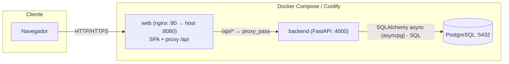
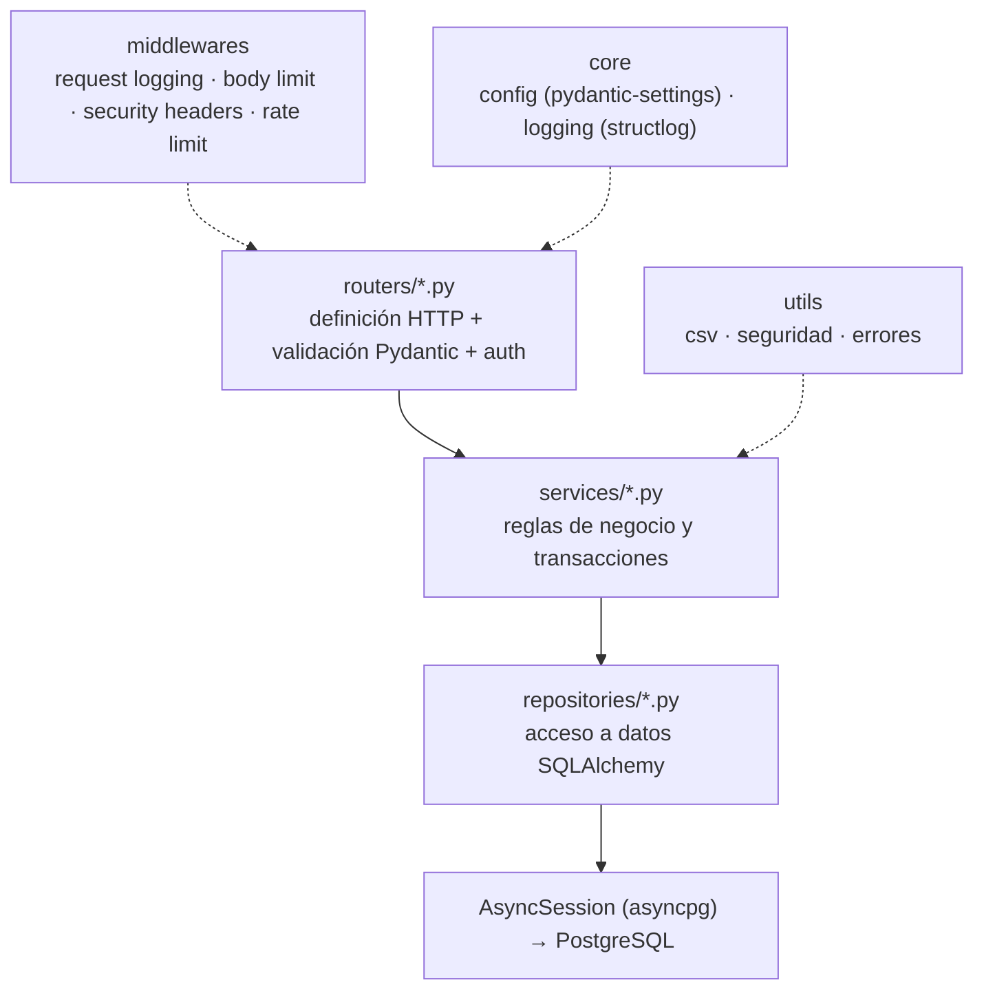
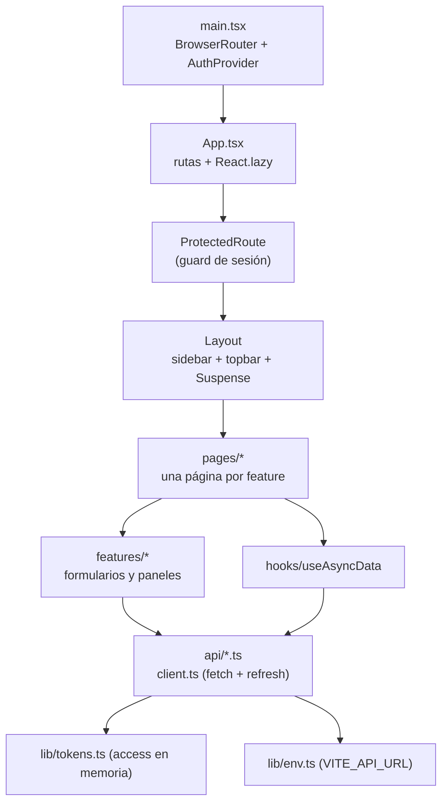
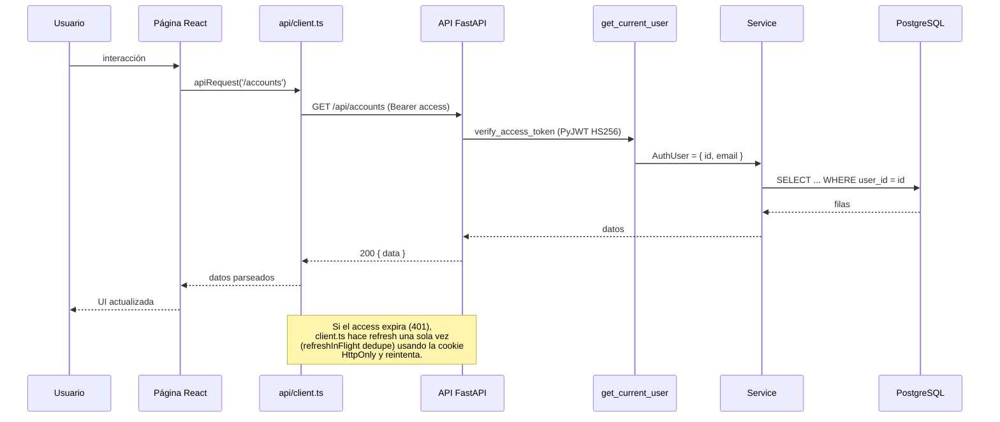
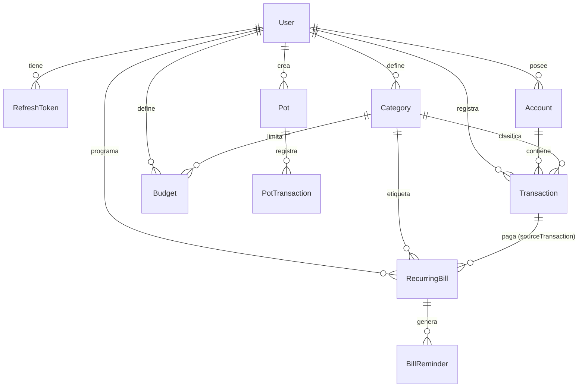

# Documentación técnica — Aplicación de Finanzas Personales (COP)

> Gestor de finanzas personales estilo dashboard (tipo Monzo) con modelado relacional
> completo, API REST, SPA React y visualización de datos. Moneda: **Peso colombiano (COP)**,
> locale `es-CO`.
>
> Documento único de referencia: visión, arquitectura, modelo de datos, API completa,
> lógica de negocio, frontend, seguridad (con auditoría), operación, despliegue, testing
> y convenciones.

---

## Índice

1. [Resumen ejecutivo](#1-resumen-ejecutivo)
2. [Visión general](#2-visión-general)
3. [Arquitectura](#3-arquitectura)
4. [Stack tecnológico](#4-stack-tecnológico)
5. [Estructura del repositorio](#5-estructura-del-repositorio)
6. [Modelo de datos](#6-modelo-de-datos)
7. [API REST](#7-api-rest)
8. [Lógica de negocio](#8-lógica-de-negocio)
9. [Frontend](#9-frontend)
10. [Seguridad](#10-seguridad)
11. [Variables de entorno](#11-variables-de-entorno)
12. [Base de datos y operación](#12-base-de-datos-y-operación)
13. [Puesta en marcha](#13-puesta-en-marcha)
14. [Despliegue](#14-despliegue)
15. [Testing](#15-testing)
16. [Convenciones y contribución](#16-convenciones-y-contribución)
17. [Apéndices](#17-apéndices)

---

## 1. Resumen ejecutivo

Aplicación **full-server** (no serverless) para gestionar finanzas personales en pesos
colombianos. Está dividida en dos proyectos independientes que se comunican **solo por
HTTP**:

- **`backend/`** — API REST en Python 3.12 + FastAPI, PostgreSQL y SQLAlchemy 2 async. Cubre
  autenticación, cuentas, categorías, transacciones (con importación/exportación CSV),
  presupuestos, metas de ahorro, facturas recurrentes con recordatorios y analítica con
  window functions de SQL.
- **`frontend/`** — SPA en React 19 + Vite + TypeScript, con React Router 7 y Recharts.
  Servida por nginx en producción (que además proxya `/api` al backend).

**Capacidades clave**

| Área | Qué ofrece |
|---|---|
| Autenticación | Registro, login, `me`, refresh con **rotación** de tokens y logout revocable |
| Cuentas | CRUD con tipos (corriente, ahorros, crédito, efectivo, inversión) y saldo |
| Categorías | CRUD con color, tipo (ingreso/gasto) y reglas de unicidad por tipo |
| Transacciones | CRUD, filtros, búsqueda, paginación, orden, sugerencia de categoría, CSV import/export |
| Presupuestos | Límites por categoría de gasto, cálculo de gasto/avance por ventana temporal |
| Metas de ahorro | Objetivos con depósitos/retiros e historial |
| Facturas | Recurrentes por día de vencimiento, pago que genera gasto, recordatorios (stub) |
| Analítica | Resumen, serie mensual, tendencias por categoría y evolución de saldo |
| Empaquetado | Dockerfiles (backend + nginx), `docker-compose.yml`, entrypoint con migraciones |
| CI | GitHub Actions: lint, tipos, tests y build de backend y frontend |

**Estado actual**: backend con **95 pruebas** de integración; frontend con **50 pruebas**
(Vitest + Testing Library). CI configurada con `pip-audit`, `npm audit` y Trivy. Auditoría de
seguridad completada: plan de endurecimiento A/B/C aplicado (ver [sección 10](#10-seguridad)).

---

## 2. Visión general

### 2.1 Problema y objetivo

Centralizar las finanzas personales de un usuario en COP para responder a preguntas como:
¿cuánto ingresé y gasté este mes?, ¿en qué categorías se va el dinero?, ¿voy cumpliendo mis
presupuestos?, ¿cuánto he ahorrado para una meta?, ¿qué facturas vencen pronto?

### 2.2 Alcance

| Dentro del alcance | Fuera del alcance (por ahora) |
|---|---|
| Un usuario por cuenta (multi-tenant por `userId`) | Cuentas compartidas / hogar |
| Moneda COP centralizada | Multimoneda real (el campo `currency` existe pero no se convierte) |
| Recordatorios de facturas simulados (`LOG`) | Envío real de correo (`EMAIL` es enum, no implementado) |
| Analítica descriptiva | Inversiones, préstamos, impuestos, presupuestos compartidos |
| Despliegue en contenedores | App móvil nativa |

### 2.3 Glosario

- **Cuenta (`Account`)**: contenedor de dinero con saldo y tipo.
- **Transacción (`Transaction`)**: movimiento (`INCOME`, `EXPENSE`, `TRANSFER`) asociado a
  una cuenta y, opcionalmente, a una categoría.
- **Categoría (`Category`)**: clasificación de ingresos o gastos con color.
- **Presupuesto (`Budget`)**: límite de gasto para una categoría en un periodo.
- **Meta de ahorro (`Pot`)**: objetivo de ahorro con saldo aparte del saldo de cuentas.
- **Factura (`RecurringBill`)**: gasto recurrente por día del mes.
- **Recordatorio (`BillReminder`)**: aviso generado para el vencimiento de una factura.
- **Ventana (`window`)**: rango de fechas efectivo en que aplica un presupuesto.
- **IDOR**: *Insecure Direct Object Reference*; aquí mitigado verificando propiedad por
  `userId` en cada acceso.

---

## 3. Arquitectura

### 3.1 Diagrama de despliegue



- En **producción**, nginx sirve la SPA y reenvía `/api/` a `backend:4000`: mismo origen,
  sin CORS.
- En **desarrollo**, la SPA (Vite `:5173`) llama directamente a `http://localhost:4000/api`,
  por lo que CORS sí aplica (`CORS_ORIGIN`).

### 3.2 Arquitectura del backend (por capas)



Reglas de esta arquitectura:

1. **Routers** declaran endpoints, dependencias de auth/DB y esquemas Pydantic; no contienen
   lógica de negocio.
2. **Schemas** separan entrada (`CamelRequest`, alias camelCase) de salida (`CamelModel`);
   los decimales viajan como string y las fechas en UTC.
3. **Servicios** contienen la lógica y coordinan repositorios; usan `commit=False` y un único
   `commit` cuando hay que mantener invariantes (pago de factura, importación CSV).
4. **Repositorios** encapsulan SQLAlchemy; exponen `find_owned(...)` para forzar la propiedad
   (anti-IDOR).
5. **Errores**: los servicios lanzan `AppError`; los handlers serializan
   `{ error: { message, code?, details? } }`.

### 3.3 Arquitectura del frontend



### 3.4 Flujo de una petición autenticada



---

## 4. Stack tecnológico

### 4.1 Backend

| Categoría | Tecnología | Versión | Notas |
|---|---|---|---|
| Runtime | Python | 3.12 | Venv local `.venv` |
| Framework | FastAPI | 0.150.0 | ASGI, dependencias, OpenAPI |
| Servidor | Uvicorn | 0.54.0 | `uvicorn[standard]` |
| Base de datos | PostgreSQL | 16+ (local: 18.4) | `NUMERIC(16,2)`, window functions |
| ORM | SQLAlchemy | 2.1.5 | Async, `asyncpg` 0.32 |
| Migraciones | Alembic | 1.20.0 | Migración inicial incluida |
| Auth | PyJWT (HS256) + argon2-cffi | 2.15.1 / 25.1.0 | Access + refresh; Argon2id |
| Validación | Pydantic | 2.14.1 | `CamelRequest` / `CamelModel` |
| Seguridad HTTP | slowapi + middleware propio | 0.1.10 | Rate limit, CORS, cabeceras |
| Subidas | `python-multipart` | 0.0.32 | Multipart + texto plano, límite 5 MB |
| Logs | structlog | 26.1.0 | JSON/consola según entorno |
| Tests | pytest + pytest-asyncio + httpx | 9.1 / 1.4 / 0.28 | Integración sobre HTTP |
| Lint/format/tipos | ruff + mypy | 0.17.1 / 2.4.0 | `ruff check`, `ruff format`, `mypy` |

### 4.2 Frontend

| Categoría | Tecnología | Versión | Notas |
|---|---|---|---|
| UI | React | ^19.2.8 | `StrictMode` |
| Build | Vite | ^8.3.0 | `@vitejs/plugin-react` |
| Lenguaje | TypeScript | ~6.0.2 | Sin enums (`erasableSyntaxOnly`) |
| Router | react-router-dom | ^7.18.4 | `BrowserRouter` + `React.lazy` |
| Gráficas | recharts | ^3.10.1 | Barras, líneas, pie |
| Tests | vitest + Testing Library + jsdom | ^5 / ^16 / ^30 | `globals: true` |
| Lint | oxlint | ^1.81.0 | |
| Servidor prod | nginx | 1.27-alpine | SPA fallback + proxy `/api` |

---

## 5. Estructura del repositorio

```text
.
├── backend/                          API REST (proyecto independiente)
│   ├── app/
│   │   ├── main.py                   create_app(): CORS, middlewares, routers, lifespan
│   │   ├── core/                     config, logging, errores, seguridad, cookies, rate limit
│   │   ├── db/                       engine async, sesión UTC, modelos y enums
│   │   ├── dependencies/             auth (Bearer) y sesión de BD
│   │   ├── routers/                  un router por recurso
│   │   ├── schemas/                  Pydantic v2 (camelCase, validación)
│   │   ├── services/                 reglas de negocio (incl. transaction_csv_service)
│   │   ├── repositories/             SQLAlchemy (incl. analytics con SQL raw)
│   │   └── utils/                    csv (escape/parseo)
│   ├── migrations/                   migraciones Alembic
│   ├── scripts/seed.py               seed determinista (usuario demo)
│   ├── tests/                        pruebas de integración + helpers
│   ├── Dockerfile                    Python 3.12-slim + usuario no-root
│   ├── docker-entrypoint.sh          alembic upgrade head + uvicorn
│   ├── alembic.ini
│   ├── pyproject.toml                configuración de ruff, mypy y pytest
│   ├── requirements.txt / requirements-dev.txt
│   └── .env.example
├── frontend/                         SPA React (proyecto independiente)
│   ├── src/
│   │   ├── api/                      client.ts + un módulo por recurso + types.ts
│   │   ├── components/               Layout, ProtectedRoute
│   │   ├── features/                 auth, transactions, pots, bills
│   │   ├── hooks/useAsyncData.ts     hook de carga de datos
│   │   ├── lib/                      env, tokens, formatCOP, labels, dates
│   │   ├── pages/                    una página por ruta (+ tests)
│   │   ├── test/setup.ts             jest-dom + polyfill ResizeObserver
│   │   ├── App.tsx / main.tsx / index.css
│   │   └── env.d.ts
│   ├── Dockerfile                    build Vite + nginx
│   ├── nginx.conf                    SPA fallback + proxy /api + gzip + cache
│   ├── vite.config.ts                plugin React + config vitest
│   └── .env.example
├── .github/workflows/ci.yml          CI (backend + frontend)
├── docker-compose.yml                postgres + backend + web
├── .env.example                      variables para docker compose
├── README.md                         guía breve de arranque
└── DOCUMENTACION.md                  este documento
```

---

## 6. Modelo de datos

Definido en `backend/app/db/models/`. **10 tablas y 7 enums**. Los importes usan
`NUMERIC(16,2)`; los IDs son `UUID` (`gen_random_uuid()`) y las fechas `TIMESTAMPTZ` en UTC.

### 6.1 Diagrama entidad-relación



### 6.2 Enums

| Enum | Valores |
|---|---|
| `AccountType` | `CHECKING`, `SAVINGS`, `CREDIT`, `CASH`, `INVESTMENT` |
| `CategoryType` | `INCOME`, `EXPENSE` |
| `TransactionType` | `INCOME`, `EXPENSE`, `TRANSFER` |
| `BudgetPeriod` | `WEEKLY`, `MONTHLY`, `QUARTERLY`, `YEARLY` |
| `PotTransactionType` | `DEPOSIT`, `WITHDRAW` |
| `ReminderChannel` | `EMAIL`, `LOG` |
| `ReminderStatus` | `PENDING`, `SENT`, `FAILED` |

### 6.3 Tablas

| Tabla | Campos destacados | Reglas / índices |
|---|---|---|
| `users` | `id`, `email` (único), `passwordHash`, `name`, `createdAt`, `updatedAt` | — |
| `refresh_tokens` | `tokenHash` (único), `expiresAt`, `revokedAt`, `userAgent`, `ip` | índice `userId`; cascade al borrar usuario |
| `accounts` | `name`, `type`, `balance Decimal(16,2)`, `currency` (def. `COP`) | índice `userId` |
| `categories` | `name`, `type`, `color`, `isCustom` | único `(userId, name, type)`; índice `userId` |
| `transactions` | `amount`, `type`, `description`, `merchant`, `date` | índices `(userId,date)`, `categoryId`, `merchant`, `(accountId,date)` |
| `budgets` | `limitAmount`, `period`, `startDate`, `endDate` | índices `userId`, `categoryId` |
| `pots` | `targetAmount`, `currentAmount`, `color` | índice `userId` |
| `pot_transactions` | `amount`, `type`, `date`, `note` | índice `(potId,date)` |
| `recurring_bills` | `amount`, `dueDay`, `isActive`, `sourceTransactionId` | índices `userId`, `categoryId` |
| `bill_reminders` | `dueDate`, `channel`, `status`, `sentAt` | índice `(billId,dueDate)` |

### 6.4 Reglas de integridad (borrado)

- `User` → **cascade** sobre todas sus entidades.
- `Account` → **cascade** sobre sus `transactions` (borrar cuenta borra movimientos).
- `Category` → `SetNull` en `transactions` y `recurring_bills` (la transacción/factura
  queda sin categoría al borrarla).
- `RecurringBill.sourceTransaction` → `SetNull`.
- `Pot` → **cascade** sobre `pot_transactions`.

---

## 7. API REST

- **Base**: `http://localhost:4000/api` (dev) o `/api` (producción vía nginx).
- **Autenticación**: `Authorization: Bearer <accessToken>` en todo salvo `health` y `auth/*`
  públicos (`register`, `login`, `refresh`, `logout`).
- **Formato de éxito**: `{ "data": ... }`; las listas paginadas añaden `meta`.
- **Formato de error**:
  ```json
  { "error": { "message": "…", "code": "OPCIONAL", "details": "opcional" } }
  ```
- **Códigos**: `200` OK, `201` creado, `204` sin contenido, `400/401/404/409/415/422/429`.

### 7.1 Resumen de endpoints

| Método | Ruta | Auth | Descripción |
|---|---|---|---|
| GET | `/api/health` | No | Estado del servicio |
| POST | `/api/auth/register` | No | Crear cuenta de usuario |
| POST | `/api/auth/login` | No | Iniciar sesión |
| POST | `/api/auth/refresh` | Cookie | Rotar credenciales (refresh en cookie HttpOnly) |
| POST | `/api/auth/logout` | Cookie | Revocar refresh token y borrar cookie |
| GET | `/api/auth/me` | Sí | Usuario actual |
| GET/POST | `/api/accounts` | Sí | Listar / crear cuentas |
| GET/PUT/DELETE | `/api/accounts/:id` | Sí | Detalle / editar / borrar |
| GET/POST | `/api/categories` | Sí | Listar / crear categorías |
| GET/PUT/DELETE | `/api/categories/:id` | Sí | Detalle / editar / borrar |
| GET | `/api/transactions` | Sí | Listar (filtros + paginación) |
| POST | `/api/transactions` | Sí | Crear transacción |
| GET/PUT/DELETE | `/api/transactions/:id` | Sí | Detalle / editar / borrar |
| PATCH | `/api/transactions/:id/category` | Sí | Asignar/quitar categoría |
| GET | `/api/transactions/suggestions` | Sí | Sugerir categoría por comercio |
| GET | `/api/transactions/export.csv` | Sí | Exportar CSV |
| POST | `/api/transactions/import` | Sí | Importar CSV |
| GET/POST | `/api/budgets` | Sí | Listar / crear presupuestos |
| GET | `/api/budgets/overview` | Sí | Avance de presupuestos |
| GET/PUT/DELETE | `/api/budgets/:id` | Sí | Detalle / editar / borrar |
| GET/POST | `/api/pots` | Sí | Listar / crear metas de ahorro |
| GET/PUT/DELETE | `/api/pots/:id` | Sí | Detalle / editar / borrar |
| POST | `/api/pots/:id/deposit` \| `/withdraw` | Sí | Movimientos de metas de ahorro |
| GET/POST | `/api/bills` | Sí | Listar / crear facturas |
| GET | `/api/bills/upcoming` | Sí | Próximos vencimientos |
| POST | `/api/bills/reminders/run` | Sí | Generar recordatorios en lote |
| GET/PUT/DELETE | `/api/bills/:id` | Sí | Detalle / editar / borrar |
| GET/POST | `/api/bills/:id/reminders` | Sí | Listar / crear recordatorios |
| POST | `/api/bills/:id/pay` | Sí | Pagar factura (crea gasto) |
| GET | `/api/analytics/summary` | Sí | Totales + desglose |
| GET | `/api/analytics/monthly` | Sí | Serie mensual |
| GET | `/api/analytics/category-trends` | Sí | Tendencias por categoría |
| GET | `/api/analytics/balance-timeline` | Sí | Evolución del saldo |

### 7.2 Health

```bash
curl http://localhost:4000/api/health
# { "status": "ok", "service": "finanzas-backend", "uptime": 12.3, "timestamp": "...", "environment": "development" }
```

### 7.3 Autenticación

**Registro** — `POST /api/auth/register`

```bash
curl -X POST http://localhost:4000/api/auth/register \
  -H "Content-Type: application/json" \
  -d '{"name":"Ana","email":"ana@ejemplo.com","password":"Secreta123"}'
```

Campos: `name` (2–80), `email` (email válido, se normaliza a minúsculas), `password` (8–128).
Respuesta `201` (el **refresh token** viaja en una cookie `refresh_token` `HttpOnly`; nunca en el cuerpo):

```json
{
  "user": { "id": "5f1c…", "email": "ana@ejemplo.com", "name": "Ana", "createdAt": "..." },
  "accessToken": "eyJ…"
}
```

Cookie emitida: `refresh_token=…; Path=/api/auth; HttpOnly; SameSite=Strict` (`Secure` en producción).

**Login** — `POST /api/auth/login`

```bash
curl -X POST http://localhost:4000/api/auth/login \
  -H "Content-Type: application/json" \
  -d '{"email":"demo@finanzas.test","password":"Demo1234!"}'
```

Credenciales inválidas → `401 { "error": { "code": "INVALID_CREDENTIALS" } }`.

**Refresh** — `POST /api/auth/refresh` (rota el refresh: el anterior queda revocado). Se autentica
con la cookie `refresh_token` (no lleva cuerpo); requiere coincidencia de `Origin` (defensa CSRF).

```bash
curl -X POST http://localhost:4000/api/auth/refresh \
  -H "Cookie: refresh_token=eyJ…"
```

**Logout** — `POST /api/auth/logout` (revoca el refresh y borra la cookie) → `{ "success": true }`

**Me** — `GET /api/auth/me`

```bash
curl http://localhost:4000/api/auth/me -H "Authorization: Bearer $ACCESS"
# { "user": { "id": "…", "email": "…", "name": "…", "createdAt": "…" } }
```

### 7.4 Cuentas

```bash
# Listar
curl http://localhost:4000/api/accounts -H "Authorization: Bearer $ACCESS"

# Crear
curl -X POST http://localhost:4000/api/accounts \
  -H "Authorization: Bearer $ACCESS" -H "Content-Type: application/json" \
  -d '{"name":"Nequi","type":"CASH","balance":250000,"currency":"COP"}'

# Actualizar / borrar
curl -X PUT http://localhost:4000/api/accounts/$ID \
  -H "Authorization: Bearer $ACCESS" -H "Content-Type: application/json" \
  -d '{"name":"Nequi Personal"}'
curl -X DELETE http://localhost:4000/api/accounts/$ID -H "Authorization: Bearer $ACCESS"
```

`type` ∈ `CHECKING | SAVINGS | CREDIT | CASH | INVESTMENT`. `balance` por defecto `0`.
`currency` de 3 letras (def. `COP`). En `PUT` debe enviarse al menos un campo.

### 7.5 Categorías

```bash
curl -X POST http://localhost:4000/api/categories \
  -H "Authorization: Bearer $ACCESS" -H "Content-Type: application/json" \
  -d '{"name":"Mascotas","type":"EXPENSE","color":"#f59e0b"}'
```

`name` (1–60), `type` ∈ `INCOME | EXPENSE`, `color` hex `#RRGGBB` (def. `#64748b`).
Nombre+tipo duplicado → `409 CATEGORY_EXISTS`. En `PUT` **no** se puede cambiar el tipo.

### 7.6 Transacciones

**Listar** — `GET /api/transactions`

| Query | Valores | Def. |
|---|---|---|
| `page` | entero ≥ 1 | 1 |
| `limit` | entero 1–100 | 10 |
| `search` | texto (comercio o descripción) | — |
| `sort` | `date` \| `amount` \| `createdAt` | `date` |
| `order` | `asc` \| `desc` | `desc` |
| `categoryId`, `accountId` | id | — |
| `type` | `INCOME` \| `EXPENSE` \| `TRANSFER` | — |
| `from`, `to` | fecha ISO | — |

```bash
curl "http://localhost:4000/api/transactions?page=1&limit=10&search=uber&type=EXPENSE&order=desc" \
  -H "Authorization: Bearer $ACCESS"
# { "data": [ … ], "meta": { "total": 12, "page": 1, "limit": 10, "totalPages": 2 } }
```

**Crear** — `POST /api/transactions`

```bash
curl -X POST http://localhost:4000/api/transactions \
  -H "Authorization: Bearer $ACCESS" -H "Content-Type: application/json" \
  -d '{"accountId":"'$ACC'","categoryId":"'$CAT'","amount":45000,"type":"EXPENSE","merchant":"Uber","date":"2026-10-18"}'
```

`amount > 0` (magnitud; el signo lo da `type`), `date` parseable. Ajusta el saldo de la
cuenta de forma atómica. Si `categoryId` no pertenece al usuario → `404 CATEGORY_NOT_FOUND`.

**Cambiar categoría** — `PATCH /api/transactions/:id/category`

```bash
curl -X PATCH http://localhost:4000/api/transactions/$ID/category \
  -H "Authorization: Bearer $ACCESS" -H "Content-Type: application/json" \
  -d '{"categoryId":null}'
```

**Sugerencias** — `GET /api/transactions/suggestions?merchant=uber`

```json
{ "suggestions": [ { "category": { "id": "…", "name": "Transporte", "color": "#0ea5e9", "type": "EXPENSE" }, "count": 7, "confidence": 0.58 } ] }
```

**Exportar CSV** — `GET /api/transactions/export.csv?...` (mismos filtros que `list`, sin
paginación). Devuelve `text/csv` con BOM UTF-8. Cabeceras:
`fecha,tipo,monto,cuenta,categoria,comercio,descripcion`.

```bash
curl -L "http://localhost:4000/api/transactions/export.csv?type=EXPENSE" \
  -H "Authorization: Bearer $ACCESS" -o transacciones.csv
```

**Importar CSV** — `POST /api/transactions/import` (multipart `file`, o cuerpo `text/csv`)

```bash
curl -X POST http://localhost:4000/api/transactions/import \
  -H "Authorization: Bearer $ACCESS" -F "file=@mis_movimientos.csv"
# { "data": { "total": 30, "imported": 27, "skipped": 1, "errors": [ { "row": 5, "message": "cuenta no encontrada: \"X\"" } ] } }
```

Ver [sección 8.6](#86-importación-y-exportación-csv) para el detalle del formato.

### 7.7 Presupuestos

```bash
# Listar (opcional ?period=MONTHLY)
curl "http://localhost:4000/api/budgets" -H "Authorization: Bearer $ACCESS"

# Crear
curl -X POST http://localhost:4000/api/budgets \
  -H "Authorization: Bearer $ACCESS" -H "Content-Type: application/json" \
  -d '{"categoryId":"'$CAT'","limitAmount":500000,"period":"MONTHLY","startDate":"2026-10-01","endDate":null}'

# Overview (avance del periodo)
curl "http://localhost:4000/api/budgets/overview?from=2026-10-01&to=2026-10-31" \
  -H "Authorization: Bearer $ACCESS"
```

Respuesta de `overview`:

```json
{
  "data": {
    "from": "2026-10-01T00:00:00.000Z",
    "to": "2026-10-31T23:59:59.999Z",
    "budgets": [
      { "id": "…", "category": { "id": "…", "name": "Transporte", "color": "#0ea5e9", "type": "EXPENSE" },
        "limitAmount": "400000.00", "period": "MONTHLY", "startDate": "…", "endDate": null,
        "spent": 285000, "remaining": 115000, "percentage": 71.3, "exceeded": false,
        "window": { "from": "…", "to": "…" } }
    ],
    "totals": { "limitAmount": 3400000, "spent": 2100000, "remaining": 1300000 }
  }
}
```

Solo se presupuestan **categorías de gasto**; lo contrario → `422 BUDGET_INVALID_CATEGORY`.

### 7.8 Metas de ahorro

```bash
curl -X POST http://localhost:4000/api/pots \
  -H "Authorization: Bearer $ACCESS" -H "Content-Type: application/json" \
  -d '{"name":"Viaje","targetAmount":2000000,"color":"#22c55e"}'

curl -X POST http://localhost:4000/api/pots/$ID/deposit \
  -H "Authorization: Bearer $ACCESS" -H "Content-Type: application/json" \
  -d '{"amount":300000,"note":"Aporte mensual"}'

curl -X POST http://localhost:4000/api/pots/$ID/withdraw \
  -H "Authorization: Bearer $ACCESS" -H "Content-Type: application/json" \
  -d '{"amount":100000}'
```

`GET /api/pots/:id?limit=20` devuelve la meta con sus últimos movimientos. Retirar más del
saldo → `422 POT_INSUFFICIENT_FUNDS`. Las metas de ahorro **no** alteran el saldo de las
cuentas.

### 7.9 Facturas

```bash
# Listar (?isActive=true|false)
curl "http://localhost:4000/api/bills?isActive=true" -H "Authorization: Bearer $ACCESS"

# Crear
curl -X POST http://localhost:4000/api/bills \
  -H "Authorization: Bearer $ACCESS" -H "Content-Type: application/json" \
  -d '{"name":"Internet","amount":120000,"categoryId":"'$CAT'","dueDay":15,"isActive":true}'

# Próximos vencimientos (días)
curl "http://localhost:4000/api/bills/upcoming?days=30" -H "Authorization: Bearer $ACCESS"

# Pagar (crea un gasto y lo enlaza)
curl -X POST http://localhost:4000/api/bills/$ID/pay \
  -H "Authorization: Bearer $ACCESS" -H "Content-Type: application/json" \
  -d '{"accountId":"'$ACC'","amount":120000}'

# Recordatorios de una factura
curl http://localhost:4000/api/bills/$ID/reminders -H "Authorization: Bearer $ACCESS"
curl -X POST http://localhost:4000/api/bills/$ID/reminders \
  -H "Authorization: Bearer $ACCESS" -H "Content-Type: application/json" \
  -d '{"channel":"LOG","send":true}'

# Generar recordatorios en lote para los próximos N días
curl -X POST http://localhost:4000/api/bills/reminders/run \
  -H "Authorization: Bearer $ACCESS" -H "Content-Type: application/json" \
  -d '{"days":7,"channel":"LOG"}'
```

`dueDay` 1–31 (clamp al último día del mes si el mes no lo tiene). Crear un recordatorio
duplicado (misma factura + fecha) → `409 REMINDER_EXISTS`. Los recordatorios son **stub**:
registran `LOG` y son idempotentes por `(billId, dueDate)`.

### 7.10 Analítica

| Endpoint | Query | Devuelve |
|---|---|---|
| `/analytics/summary` | `from`, `to` | `totals {income, expense, net, savingsRate}`, `byCategory[]`, `byAccount[]` |
| `/analytics/monthly` | `months` (1–24, def. 6) | `months[] {month, income, expense, net, cumulativeNet}` |
| `/analytics/category-trends` | `months` (1–24, def. 6) | `trends[] {month, categoryId, categoryName, color, total, previous, changePct}` |
| `/analytics/balance-timeline` | `from`, `to`, `limit` (1–2000, def. 500) | `timeline[] {date, delta, runningBalance}` |

```bash
curl "http://localhost:4000/api/analytics/summary?from=2026-10-01&to=2026-10-31" \
  -H "Authorization: Bearer $ACCESS"
```

Si no se envían fechas, `summary` usa del **inicio del mes actual** hasta ahora.

---

## 8. Lógica de negocio

### 8.1 Montos y signos

- Los importes se almacenan como **magnitud positiva** (`Decimal(16,2)`); el signo lo
  determina `type` (`INCOME` suma, `EXPENSE`/`TRANSFER` restan saldo).
- El frontend formatea con `Intl.NumberFormat('es-CO', { currency: 'COP' })`.

### 8.2 Saldo de cuenta (transacciones)

`transaction_service.create/update/remove` ejecutan la transacción y el ajuste de saldo en
la misma `AsyncSession` con un único `commit`:

- **Crear**: incrementa/decrementa el saldo según `signedAmount(type, amount)`.
- **Actualizar**: revierte el efecto anterior y aplica el nuevo, incluso si cambia de cuenta.
- **Borrar**: revierte el efecto y elimina la fila.

Se valida propiedad de `accountId` y `categoryId` antes de operar (anti-IDOR).

### 8.3 Presupuestos

- Solo aplican a categorías `EXPENSE` (validado en create/update).
- `overview` intersecta la ventana del presupuesto con el rango consultado
  (`intersect`): `window = [max(startDate, from), min(endDate ?? to, to)]`.
- Suma los gastos de la categoría dentro de esa ventana y calcula `spent`, `remaining`,
  `percentage` y `exceeded` (`spent > limit`).

### 8.4 Metas de ahorro

- `currentAmount` se mantiene con `increment`/`decrement` en una transacción atómica junto
  al registro del `PotTransaction`.
- `withdraw` valida saldo suficiente (`POT_INSUFFICIENT_FUNDS`).
- `percentage`, `remaining` y `completed` (`current >= target`) se calculan al serializar.
- Las metas de ahorro son un fondo independiente: no afectan `Account.balance`.

### 8.5 Facturas y recordatorios

- La factura es un gasto **recurrente** por `dueDay`.
- `billTiming` calcula el próximo vencimiento (o el del mes actual si está vencido y no
  pagado), los días restantes y si está vencida.
- `overdue` = activa, día ya pasado y sin pago este mes (se detecta por `sourceTransaction`).
- **Pagar** (`pay`) crea un `EXPENSE` vía `transactionService` (ajusta saldo) y enlaza la
  transacción como `sourceTransactionId`.
- **Recordatorios**: `createReminder` y `runReminders` son idempotentes por
  `(billId, dueDate)`; el "envío" es un `logger.info(..., { stub: true })`.

### 8.6 Importación y exportación CSV

**Export** (`transactionCsv.service.ts` → `utils/csv.ts`):
- Cabecera `fecha,tipo,monto,cuenta,categoria,comercio,descripcion`.
- Fechas `YYYY-MM-DD`, montos `toFixed(2)`, tipo en español (`ingreso`/`gasto`/`transferencia`).
- BOM UTF-8 al inicio (`\uFEFF`) para Excel.
- Escapado CSV básico (comillas, comas, saltos de línea).

**Import**:
- Parser CSV propio (soporta comillas y comillas escapadas `""`).
- Alias de columnas aceptados (ES/EN): `fecha/date`, `monto/valor/amount`, `tipo/type`,
  `cuenta/account`, `categoria/category`, `comercio/merchant`, `descripcion/detalle/description`.
- Requiere al menos `fecha` y `monto` (si no → `400 CSV_MISSING_COLUMNS`).
- `parseAmount` entiende formatos `1.234,56` y `1,234.56`.
- `parseDate` acepta `dd/mm/yyyy`, `dd-mm-yyyy` e ISO.
- Resolución de cuenta por nombre (normalizado, sin acentos) o por id.
- Categoría por nombre y tipo (fallback: solo por nombre).
- **Deduplicación** por clave `(cuenta, fecha, monto, tipo, comercio)` contra lo existente.
- Devuelve `{ total, imported, skipped, errors[] }` con el número de fila de cada error.

### 8.7 Analítica (SQL con window functions)

`analytics_repository.py` usa `text()` con **parámetros vinculados** y la sesión en UTC:

- `totals`: `SUM(...) FILTER (WHERE type=…)` + neto.
- `expenseByCategory`: porcentaje con `SUM(SUM(...)) OVER ()` y `RANK() OVER (ORDER BY …)`.
- `netByAccount`: `LEFT JOIN` con `accounts`, cuenta y neto por cuenta.
- `monthlySeries`: `generate_series` de meses + `SUM(...) OVER (ORDER BY month)` para el
  acumulado; los casts `::float8`/`::int` devuelven números, no strings de `Decimal`.
- `categoryTrends`: `LAG(...)` por categoría para la variación mes a mes.
- `balanceTimeline`: saldo acumulado con ventana `ROWS BETWEEN UNBOUNDED PRECEDING AND CURRENT ROW`.

La conexión fija `timezone=UTC` en `app/db/session.py`; de lo contrario PostgreSQL usa la
zona local del servidor y las etiquetas mensuales se desplazan un mes.

### 8.8 Sugerencia de categoría

`transaction_service.suggestions(merchant)` busca hasta 500 transacciones recientes del
usuario cuyo comercio contenga el término, cuenta categorías y devuelve las 3 más
frecuentes con `confidence = count / total` (redondeado a 2 decimales).

---

## 9. Frontend

### 9.1 Arranque y enrutado

`main.tsx` monta `BrowserRouter > AuthProvider > App`. `App.tsx` define:

- **Públicas (eager)**: `/login`, `/register`.
- **Protegidas (lazy)**: tras `ProtectedRoute` y `Layout`: `/` (dashboard),
  `/transactions`, `/budgets`, `/pots`, `/bills`, `/analytics`, `/accounts`,
  `/categories` y `*` (404).

El code-splitting usa `React.lazy(() => import(...).then(m => ({ default: m.X })))` y un
`<Suspense>` en `Layout`. Esto aísla Recharts (chunk de `AnalyticsPage`) del bundle inicial.

### 9.2 Cliente HTTP (`api/client.ts`)

- `apiRequest`, `apiUpload`, `apiDownload` comparten `authFetch`.
- `authFetch` añade `Authorization: Bearer` y, ante `401`, intenta **un** refresh y reintenta
  (deduplicado con `refreshInFlight`).
- `ApiError` lleva `status`, `code` y `details`.
- `tokenStore` (`lib/tokens.ts`) guarda el **access token solo en memoria**; el **refresh token**
  vive en una cookie `HttpOnly`, por lo que la SPA ya no persiste credenciales en `localStorage`.
  Todas las peticiones usan `credentials: 'include'`.

### 9.3 Estado: `useAsyncData`

Hook propio con `{ data, error, loading, reload }`. Las dependencias son `[fetcher, reloadKey]`,
por lo que los `fetcher` deben ser estables (`useCallback`). Uso sistemático en páginas y
paneles.

### 9.4 Autenticación en el cliente

- `AuthProvider` guarda `user`, hace bootstrap con `authApi.me()` si hay token, y expone
  `login`, `register`, `logout`.
- `ProtectedRoute` redirige a `/login` (recordando `from`) si no hay usuario.
- `Layout` muestra el usuario y permite cerrar sesión.

### 9.5 Página por página

| Ruta | Página | Contenido | APIs |
|---|---|---|---|
| `/` | `DashboardPage` | 4 cards (ingresos/gastos/neto/tasa) + 4 paneles (vencimientos, presupuestos, metas de ahorro, últimas transacciones) | `analytics.summary`, `bills.upcoming`, `budgets.overview`, `pots.list`, `transactions.list` |
| `/transactions` | `TransactionsPage` | Tabla con filtros, búsqueda debounced (300 ms), orden, paginación, export/import CSV, categorización inline | `transactions.*`, `accounts.list`, `categories.list` |
| `/budgets` | `BudgetsPage` | Rango de fechas, cards de totales, lista de barras de progreso, CRUD | `budgets.overview/list`, `categories.list` |
| `/pots` | `PotsPage` | Tarjetas de progreso, CRUD, paneles de depósito/retiro | `pots.*` |
| `/bills` | `BillsPage` | Tabla con estado/vencimiento, CRUD, activar/desactivar, pagar, recordatorios, "generar recordatorios (7 días)" | `bills.*`, `accounts.list`, `categories.list` |
| `/analytics` | `AnalyticsPage` | Selector 3/6/12 meses, 4 cards, barras ingresos vs gastos, pie por categoría, línea de saldo, tabla de variación | `analytics.*` |
| `/accounts` | `AccountsPage` | Tabla + formulario crear/editar | `accounts.*` |
| `/categories` | `CategoriesPage` | Tabla con color + formulario (tipo fijo al editar) | `categories.*` |
| `/login`, `/register` | `LoginPage`, `RegisterPage` | Formularios con validación HTML5 (login prellenado con el demo) | `auth.*` |
| `*` | `NotFoundPage` | 404 con enlace al resumen | — |

### 9.6 Componentes de feature

- `TransactionForm`: alta/edición, sugiere categorías por comercio (debounce 400 ms, ≥3
  caracteres) y filtra categorías por tipo.
- `PotMovePanel`: alterna depósito/retiro, muestra movimientos recientes.
- `BillPayPanel`: paga la factura eligiendo cuenta/monto/fecha.
- `BillRemindersPanel`: lista y crea recordatorios (`LOG`, `send: true`).

### 9.7 Formato y estilos

- `lib/formatCOP.ts`: `formatCOP`, `formatNumber`, `formatPercent` (locale `es-CO`).
- `lib/dates.ts`: `formatDate`, `toDateInputValue`, `startOfMonthInput`, `endOfMonthInput`,
  `formatMonthLabel`.
- `lib/labels.ts`: etiquetas en español de tipos y periodos.
- `index.css`: tema oscuro (variables CSS), clases reutilizables (`.card`, `.panel`,
  `.data-table`, `.progress-fill`, `.badge`, `.charts`, etc.).

---

## 10. Seguridad

### 10.1 Controles ya implementados

- **Hashing de contraseñas** con Argon2id (`memory_cost 19456`, `time_cost 2`, `hash_len 32`).
- **JWT**: access y refresh firmados (HS256, PyJWT) con issuer/audience fijos y secretos
  distintos (mínimo 32 caracteres validado por pydantic-settings).
- **Refresh tokens hasheados** (SHA-256) en BD, con rotación, expiración y revocación.
- **Autorización por propiedad**: todos los repositorios exponen `find_owned`; recursos
  ajenos responden `404`.
- **SQL parametrizado**: analítica con `text()` y parámetros vinculados (incluido `LIMIT`).
- **Validación de entrada** con Pydantic v2 en body, params y query.
- **Middlewares propios**, **CORS** restringido por `CORS_ORIGIN`, **rate limit** global
  (300/15 min) con slowapi.
- **Subida de CSV**: límite 5 MB, 1 archivo, allowlist de mimetype/extensión.
- **Contenedor backend** ejecuta como usuario `appuser` (no root).
- **Secretos**: `.env` nunca versionado (los `*.example` sí).

### 10.2 Auditoría de los 11 puntos revisados

| # | Punto | Estado | Detalle |
|---|---|---|---|
| 1 | Inyección SQL en SQL raw | OK | `text()` con parámetros vinculados en `analytics_repository.py` |
| 2 | IDOR / control de propiedad | OK | `find_owned` en todos los repos + tests de IDOR en create/update y export/import |
| 3 | Almacenamiento de tokens | OK | Refresh en cookie `HttpOnly` `SameSite=Strict`; access solo en memoria; endpoints con cookie verifican `Origin` (CSRF) |
| 4 | Reuso de refresh tokens | OK | Rotación + detección de reuso que revoca toda la familia (`revoke_all_for_user`) |
| 5 | Rate limiting | OK | Global 300/15 min + límite por endpoint de auth (login 10, register 20, refresh 60) |
| 6 | Cabeceras de seguridad | OK | Middleware de cabeceras + CSP/HSTS/`X-Frame-Options`/`Referrer-Policy`/`Permissions-Policy` en nginx |
| 7 | CSV (inyección / límites) | OK | Allowlist en import; saneo anti fórmula en export; tope de 5000 filas y 2000 caracteres por campo |
| 8 | Seed en producción | OK | `scripts/seed.py` aborta si `APP_ENV=production` salvo `SEED_FORCE=true` |
| 9 | Exposición de PostgreSQL | OK | Puerto solo en loopback `127.0.0.1`; el backend usa un rol sin superusuario (`postgres/init/01-app-role.sh`) |
| 10 | Superficie de imagen / dependencias | OK | Backend `USER appuser`; nginx con `nginxinc/nginx-unprivileged` (no root); `pip-audit` + `npm audit` + Trivy en CI |
| 11 | Fuga de datos en logs | OK | `redact_processor` de structlog para `Authorization`, cookies y campos sensibles |

### 10.3 Plan de endurecimiento aplicado (A → B → C)

> Plan **ejecutado por completo**. Cada tarea quedó en un commit propio (`git log --oneline`).

**Fase A — Backend (sin romper contratos)**
- `redact_processor` en structlog para cabeceras de autorización, cookies y campos sensibles — punto 11.
- Guardián de entorno en `scripts/seed.py` (`SEED_FORCE=true` para forzar) — punto 8.
- Detección de reuso de refresh → `revoke_all_for_user` (revoca toda la familia) — punto 4.
- Saneo anti CSV-injection en export y topes de import (5000 filas / 2000 caracteres) — punto 7.
- Rate limit específico por endpoint de auth — punto 5.
- Tests de IDOR en create/update y export/import — punto 2.

**Fase B — Infraestructura y empaquetado**
- Cabeceras de seguridad en nginx (`frontend/security-headers.conf`) — punto 6.
- `docker-compose` publica PostgreSQL solo en `127.0.0.1`; el backend usa un rol de mínimo
  privilegio — punto 9.
- nginx sobre `nginxinc/nginx-unprivileged` (no root) — punto 10.
- `pip-audit` + `npm audit` + Trivy en CI (`trivy-action` fijado por SHA, `v0.36.0`) — punto 10.

**Fase C — Autenticación en el cliente**
- Refresh token en cookie `HttpOnly` (`SameSite=Strict`, `Secure` en producción) y access solo
  en memoria, con verificación de `Origin` en los endpoints con cookie (CSRF) — punto 3.
- Ajustados `client.ts`, `AuthProvider`, `tokenStore` y `types.ts`.

#### Verificación de la Fase B sin Docker (entorno Windows)

Docker no está disponible en el entorno local, así que B1/B2/B3 se validaron con las piezas
nativas (PostgreSQL 18 y nginx), replicando la lógica de los archivos que usa compose.

**B2 — rol de BD de mínimo privilegio** (`postgres/init/01-app-role.sh`). Se ejecutaron las
mismas sentencias sobre un rol y una base desechables (`b2_app` / `b2_verify`) con `psql` y se
comprobó el estado resultante:

| Comprobación | Esperado | Obtenido |
|---|---|---|
| `rolsuper` / `rolcreatedb` / `rolcreaterole` | `f` / `f` / `f` | `f` / `f` / `f` |
| `rolcanlogin` | `t` | `t` |
| Propietario de la base | `b2_app` | `b2_app` |
| Propietario del esquema `public` | `b2_app` | `b2_app` |

Limpieza posterior (`DROP DATABASE` / `DROP ROLE`). **Observación**: el rol de desarrollo
existente `finanzas` tiene `rolcreatedb = t` (se creó antes del script); con un volumen nuevo de
compose el script lo crea como `NOCREATEDB`. Por eso, para reproducir el estado endurecido hay
que recrear el volumen (`docker compose down -v`).

**B1/B3 — cabeceras de seguridad y nginx** (`frontend/security-headers.conf`,
`frontend/nginx.conf`). Se sirvió el build real (`frontend/dist`) con nginx nativo **1.27.5**
(misma serie que la imagen `1.27-alpine`) usando un `server` idéntico al de producción. Resultado
de `curl -I`:

- `GET /` → `200` con las **6** cabeceras: `X-Content-Type-Options`, `X-Frame-Options`,
  `Referrer-Policy`, `Permissions-Policy`, `Strict-Transport-Security` y `Content-Security-Policy`.
- `GET /assets/<hash>.js` → `200` con las mismas 6 cabeceras + `Cache-Control`.
- Ruta SPA inexistente → `200` (fallback a `index.html`).

**No verificable en Windows (caveats documentados):** nginx en Windows ignora la directiva
`user` y no hay usuario Linux sin privilegios, así que el "non-root" (uid 101 en
`nginx-unprivileged`) solo se confirma al 100 % en Linux; se omitió localmente `location /api/`
porque el upstream `backend` solo resuelve dentro de compose. **Observación menor**: en
`/assets/` nginx devuelve dos cabeceras `Cache-Control` (`max-age=2592000` de `expires 30d` +
`public, immutable` de `add_header`), redundancia inofensiva que puede simplificarse.

> Pendiente únicamente la prueba end-to-end con Docker (`docker compose up --build`) en Linux
> para confirmar el "non-root" y el rol de BD dentro de contenedor.

---

## 11. Variables de entorno

### 11.1 Backend (`backend/.env`)

| Variable | Requerida | Def. | Descripción |
|---|---|---|---|
| `APP_ENV` | No | `development` | `development` \| `test` \| `production` (`NODE_ENV` también se acepta) |
| `PORT` | No | `4000` | Puerto HTTP |
| `DATABASE_URL` | **Sí** | — | Cadena de conexión PostgreSQL |
| `CORS_ORIGIN` | No | `http://localhost:5173` | Origen permitido |
| `LOG_LEVEL` | No | `info` | `fatal`…`trace` \| `silent` |
| `JWT_ACCESS_SECRET` | **Sí** | — | ≥ 32 caracteres |
| `JWT_REFRESH_SECRET` | **Sí** | — | ≥ 32 caracteres, distinto del anterior |
| `JWT_ACCESS_TTL` | No | `900` | TTL access en segundos |
| `JWT_REFRESH_TTL` | No | `604800` | TTL refresh en segundos (7 días) |
| `SEED_FORCE` | No | — | Solo seed: `true` fuerza el seed en producción |

`app/core/config.py` valida con pydantic-settings y **aborta el arranque** si algo falta o
es inválido.

### 11.2 Frontend (`frontend/.env`)

| Variable | Def. | Descripción |
|---|---|---|
| `VITE_API_URL` | `http://localhost:4000/api` | URL base de la API (en Docker se compila como `/api`) |

### 11.3 Docker Compose (`.env` en la raíz)

| Variable | Def. | Descripción |
|---|---|---|
| `POSTGRES_ADMIN_USER` / `POSTGRES_ADMIN_PASSWORD` | `postgres` / `postgres` | Superusuario del contenedor (init y healthcheck) |
| `POSTGRES_USER` | `finanzas` | Rol de aplicación (mínimo privilegio) que usa el backend |
| `POSTGRES_PASSWORD` | `finanzas` | Contraseña del rol de aplicación |
| `POSTGRES_DB` | `finanzas` | Nombre de la BD |
| `POSTGRES_PORT` | `5432` | Puerto publicado **solo en `127.0.0.1`** |
| `BACKEND_PORT` | `4000` | Puerto del backend en el host |
| `WEB_PORT` | `8080` | Puerto público del frontend (nginx) |
| `CORS_ORIGIN` | `http://localhost:8080` | Origen permitido |
| `LOG_LEVEL` | `info` | Nivel de logs |
| `JWT_ACCESS_SECRET` / `JWT_REFRESH_SECRET` | — | **Obligatorias** (`:?` en compose) |
| `JWT_ACCESS_TTL` / `JWT_REFRESH_TTL` | `900` / `604800` | TTL en segundos |

Generar secretos:

```bash
python -c "import secrets; print(secrets.token_hex(48))"
```

---

## 12. Base de datos y operación

### 12.1 Migraciones

- Migración inicial: `backend/migrations/versions/6577a9c815bf_initial_schema.py`.
- En desarrollo: `alembic revision --autogenerate -m "..."` y `alembic upgrade head`.
- En producción/contenedor: `alembic upgrade head` (se ejecuta en `docker-entrypoint.sh`).
- `tests/conftest.py` aplica `alembic upgrade head` antes de la suite contra `finanzas_test`.

### 12.2 Seed

`scripts/seed.py` genera 6 meses de datos con un PRNG de semilla fija:

- Usuario demo `demo@finanzas.test` / `Demo1234!`.
- 6 cuentas (ahorros, efectivo, corriente, tarjeta de crédito, inversión).
- 13 categorías (10 de gasto, 3 de ingreso).
- ~200 transacciones (salario, intereses, freelance, gastos fijos y variables).
- 6 presupuestos, 3 metas de ahorro, 8 facturas recurrentes con recordatorio.
- Saldos de cuenta recalculados como base + neto de transacciones.
- Aborta en producción salvo `SEED_FORCE=true` (borra todos los datos).

```bash
cd backend
.\.venv\Scripts\python.exe -m scripts.seed
```

### 12.3 Acceso a la base (entorno local Windows)

- PostgreSQL 18.4 nativo; `psql` en `C:\Program Files\PostgreSQL\18\bin\psql.exe`.
- BD de desarrollo: `finanzas` (rol `finanzas`); BD de test: `finanzas_test`.
- Usar `psql` o cualquier cliente SQL; ya no hay Prisma Studio.

### 12.4 Apagado ordenado

El `lifespan` de FastAPI registra el arranque/parada y ejecuta `dispose_engine()` al cerrar.
Uvicorn gestiona `SIGINT`/`SIGTERM` y cierra las conexiones del pool.

---

## 13. Puesta en marcha

### 13.1 Requisitos

- Python 3.12 y `pip`.
- Node.js >= 20 (recomendado 22) para el frontend.
- PostgreSQL 16+ **o** Docker.
- En Windows, usar `npm.cmd` si la ExecutionPolicy bloquea `npm.ps1`.

### 13.2 Opción A — Docker Compose (recomendada)

```bash
cp .env.example .env          # editar secretos JWT y password de Postgres
docker compose up --build
```

- Frontend (nginx): `http://localhost:8080`
- API: `http://localhost:4000/api`

El backend aplica migraciones al iniciar (`alembic upgrade head`).

### 13.3 Opción B — Local con PostgreSQL nativo

Terminal 1 (backend):

```bash
cd backend
python -m venv .venv
.\.venv\Scripts\python.exe -m pip install -r requirements-dev.txt
copy .env.example .env        # ajustar DATABASE_URL y secretos JWT
.\.venv\Scripts\python.exe -m alembic upgrade head
.\.venv\Scripts\python.exe -m scripts.seed
.\.venv\Scripts\python.exe -m uvicorn app.main:app --reload --port 4000
```

Terminal 2 (frontend):

```bash
cd frontend
copy .env.example .env        # VITE_API_URL apuntando al backend
npm.cmd install
npm.cmd run dev               # http://localhost:5173
```

### 13.4 Probar el backend en local sin Docker

```bash
cd backend
$env:APP_ENV="production"; .\.venv\Scripts\python.exe -m uvicorn app.main:app --port 4000
```

Requiere secretos JWT válidos y una `DATABASE_URL` accesible. La documentación OpenAPI se
deshabilita en producción.

### 13.5 Comandos útiles

| Backend (desde `backend/`) | Frontend (desde `frontend/`) |
|---|---|
| `.\.venv\Scripts\python.exe -m uvicorn app.main:app --reload` | `npm run dev` / `build` / `preview` |
| `.\.venv\Scripts\python.exe -m alembic upgrade head` | `npm run typecheck` / `lint` |
| `.\.venv\Scripts\python.exe -m scripts.seed` | `npm run test` / `test:watch` |
| `.\.venv\Scripts\python.exe -m ruff check` / `format` / `mypy` | — |
| `.\.venv\Scripts\python.exe -m pytest -q` | — |

---

## 14. Despliegue

### 14.1 Imágenes

- **Backend** (`backend/Dockerfile`): `python:3.12-slim`, instala `requirements.txt`, copia
  `app/`, `migrations/`, `alembic.ini` y `scripts/`, corre como usuario no-root `appuser`,
  expone `4000` y trae un `HEALTHCHECK` contra `/api/health`.
- **Frontend** (`frontend/Dockerfile`): build con Vite (`ARG VITE_API_URL=/api`) y runtime
  `nginx:1.27-alpine` sirviendo `dist`, con `HEALTHCHECK` con `wget`.

### 14.2 nginx (`frontend/nginx.conf`)

- `listen 80`, gzip para texto/JS/JSON/SVG.
- `location /api/` → `proxy_pass http://backend:4000` con cabeceras `X-Real-IP`,
  `X-Forwarded-For`, `X-Forwarded-Proto`; `client_max_body_size 10m`.
- `location /assets/` → cache 30 días `immutable`.
- `location /` → SPA fallback `try_files $uri $uri/ /index.html`.

### 14.3 Docker Compose

Servicios: `postgres` (con volumen `finanzas_postgres_data` y healthcheck `pg_isready`),
`backend` (depende de `postgres` saludable) y `web` (depende de `backend`). El backend lee
la BD por el host interno `postgres`. PostgreSQL se publica **solo en `127.0.0.1`** y el
backend se conecta con un rol de mínimo privilegio creado por `postgres/init/01-app-role.sh`.
El contenedor `web` corre nginx sin privilegios (`nginx-unprivileged`, puerto interno 8080).

### 14.4 Coolify

1. Crear un recurso apuntando al repositorio con `docker-compose.yml`.
2. Definir las variables de `.env.example` en el panel (secretos JWT y password de Postgres).
3. El backend aplica migraciones antes de arrancar.
4. El servicio `web` compila y sirve la SPA; exponer su puerto (`WEB_PORT`, def. 8080) en el
   dominio público.
5. Con proxy nginx no se necesita CORS; si se sirven en dominios distintos, apuntar
   `CORS_ORIGIN` al del frontend.

### 14.5 Integración continua

`.github/workflows/ci.yml` corre en push/PR a `main`:

- **Job `backend`**: servicio PostgreSQL 16, `pip install -r requirements-dev.txt`,
  `alembic upgrade head`, `ruff check`, `ruff format --check`, `mypy app scripts`,
  `pytest` y `compileall`.
- **Job `frontend`**: `npm ci`, `typecheck`, `lint`, `test`, `build`.
- **Job `security`**: `pip-audit`, `npm audit` y Trivy (imagen fijada por SHA).

Incluye `concurrency` (cancela ejecuciones previas) y `permissions: contents: read`.

---

## 15. Testing

### 15.1 Backend (pytest + httpx)

- **Integración sobre HTTP** con la app ASGI real y PostgreSQL real (`finanzas_test`).
- `tests/conftest.py` aplica `alembic upgrade head` y trunca tablas entre tests.
- Helpers en `tests/helpers`: sesión de BD, autenticación y fixtures de datos.
- **95 pruebas** repartidas en 9 archivos: `test_auth`, `test_accounts`, `test_categories`,
  `test_transactions`, `test_csv`, `test_budgets`, `test_pots`, `test_bills`, `test_analytics`.

```bash
cd backend
.\.venv\Scripts\python.exe -m pytest -q                  # suite completa
.\.venv\Scripts\python.exe -m pytest tests/test_auth.py -q
```

### 15.2 Frontend (Vitest + Testing Library + jsdom)

- `vite.config.ts` configura `environment: 'jsdom'`, `globals: true` y
  `setupFiles: ['./src/test/setup.ts']`.
- `setup.ts` carga `@testing-library/jest-dom` y hace polyfill de `ResizeObserver`
  (necesario para Recharts).
- **50 pruebas**: módulos `api/*`, `lib/formatCOP`, páginas (`AccountsPage`,
  `AnalyticsPage`, `BillsPage`, `BudgetsPage`, `DashboardPage`, `PotsPage`,
  `TransactionsPage`).

```bash
cd frontend
npm.cmd run test
npm.cmd run test:watch
```

### 15.3 Verificación previa a un PR

```bash
# backend (desde backend/)
.\.venv\Scripts\python.exe -m ruff check app tests scripts
.\.venv\Scripts\python.exe -m ruff format --check app tests scripts
.\.venv\Scripts\python.exe -m mypy app scripts
.\.venv\Scripts\python.exe -m pytest -q
.\.venv\Scripts\python.exe -m compileall -q app scripts

# frontend (desde frontend/)
npm.cmd run typecheck
npm.cmd run lint
npm.cmd run test
npm.cmd run build
```

---

## 16. Convenciones y contribución

### 16.1 Estilo de código

- **Python 3.12** en backend (tipos explícitos, `from __future__ import annotations` cuando
  aplica) y **TypeScript** en frontend.
- **Sin enums de TypeScript** (restricción `erasableSyntaxOnly`): se usan uniones de literales.
- **Sin comentarios** salvo donde aportan (los `oxlint-disable` justifican reglas concretas).
- Formato y lint con **ruff** + **mypy** (backend) y **oxlint** + `tsc` (frontend).
- Prefijo `I` desaconsejado; tipos como `PublicUser`, `AuthUser`, etc.

### 16.2 Organización

- Backend por capas (`routers → services → repositories`), un archivo por recurso.
- Frontend por dominio (`api`, `features`, `pages`, `lib`, `hooks`, `components`).
- Los `fetcher` de `useAsyncData` deben ser estables (`useCallback`).

### 16.3 Flujo Git

- Rama principal `main`; commits por tarea (`T1`, `T2`, …) con mensaje breve.
- No se commitean `.env`, `.venv/`, `__pycache__/`, `dist/`, `node_modules/` ni `coverage/`.
- Antes de commitear: `git status`, `git diff` y ejecutar lint, tipos y tests.

### 16.4 Roadmap

- [x] Modelo de datos y migraciones
- [x] Autenticación JWT (con rotación de refresh)
- [x] Cuentas, categorías y transacciones (CRUD, filtros, CSV)
- [x] Presupuestos, metas de ahorro, facturas y recordatorios (stub)
- [x] Analítica con window functions
- [x] Frontend React + Recharts
- [x] Integración continua (GitHub Actions)
- [x] Endurecimiento de seguridad (fases A/B/C, ver sección 10)
- [ ] Despliegue continuo

---

## 17. Apéndices

### 17.1 Receta rápida de `curl`

```bash
BASE=http://localhost:4000/api

# 1) Login y captura de tokens
ACCESS=$(curl -s -X POST $BASE/auth/login -H "Content-Type: application/json" \
  -d '{"email":"demo@finanzas.test","password":"Demo1234!"}' | python -c 'import json,sys; print(json.load(sys.stdin)["accessToken"])')

# 2) Primera cuenta y categoría
ACC=$(curl -s $BASE/accounts -H "Authorization: Bearer $ACCESS" | python -c 'import json,sys; print(json.load(sys.stdin)["data"][0]["id"])')
CAT=$(curl -s $BASE/categories -H "Authorization: Bearer $ACCESS" | python -c 'import json,sys; print(json.load(sys.stdin)["data"][0]["id"])')

# 3) Crear una transacción
curl -s -X POST $BASE/transactions -H "Authorization: Bearer $ACCESS" -H "Content-Type: application/json" \
  -d "{\"accountId\":\"$ACC\",\"categoryId\":\"$CAT\",\"amount\":25000,\"type\":\"EXPENSE\",\"merchant\":\"Café\",\"date\":\"2026-10-18\"}"

# 4) Resumen de analítica
curl -s "$BASE/analytics/summary" -H "Authorization: Bearer $ACCESS"
```

### 17.2 Códigos de error frecuentes

| Código (`error.code`) | HTTP | Cuándo |
|---|---|---|
| `VALIDATION_ERROR` | 422 | Falla un esquema Pydantic |
| `UNAUTHENTICATED` | 401 | Falta el `Bearer` o el usuario no está autenticado |
| `INVALID_TOKEN` | 401 | Access inválido/expirado |
| `INVALID_REFRESH_TOKEN` | 401 | Refresh inválido/expirado/revocado |
| `INVALID_CREDENTIALS` | 401 | Login incorrecto |
| `EMAIL_TAKEN` | 409 | Registro con email existente |
| `CATEGORY_EXISTS` | 409 | Nombre+tipo repetido |
| `REMINDER_EXISTS` | 409 | Recordatorio duplicado |
| `*_NOT_FOUND` | 404 | Recurso inexistente o ajeno |
| `BUDGET_INVALID_CATEGORY` / `BILL_INVALID_CATEGORY` | 422 | Categoría no de gasto |
| `POT_INSUFFICIENT_FUNDS` | 422 | Retiro mayor al saldo de la meta de ahorro |
| `CSV_EMPTY` / `CSV_MISSING_COLUMNS` / `CSV_REQUIRED` | 400 | Problemas de import |
| `UNSUPPORTED_FILE` / `UPLOAD_ERROR` | 415 / 400 | Subida inválida |
| `RATE_LIMITED` | 429 | Límite de peticiones superado |
| `NOT_FOUND` | 404 | Ruta desconocida |

### 17.3 Preguntas frecuentes

- **¿Por qué los recursos ajenos devuelven 404 y no 403?** Para no revelar la existencia de
  recursos de otros usuarios (mitigación de enumeración).
- **¿Transferir afecta el saldo?** Sí: `TRANSFER` resta saldo de la cuenta asociada, igual que
  un gasto (modelo simplificado; no hay doble asiento).
- **¿Las metas de ahorro descuentan de las cuentas?** No; son fondos independientes.
- **¿Los recordatorios envían correos?** No; son *stubs* que registran en el log
  (`channel: LOG`).
- **¿Por qué `GET /categories` no filtra por tipo?** El filtrado por tipo se hace en el
  cliente; el endpoint devuelve todas.
- **¿Cómo se replican los datos demo?** `python -m scripts.seed` es determinista (misma semilla).

---

> Documento generado como referencia única del proyecto. Mantener actualizado al cambiar
> contratos de API, esquema de datos, variables de entorno o el plan de seguridad.
